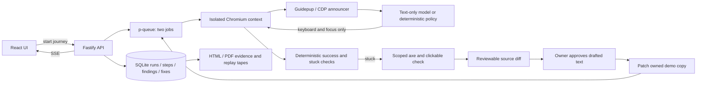

# TabTastic

**Find the block. Fix the flow !!**

Try the journey. Find the barrier. Fix the source. Prove the journey works.

A TypeScript hackathon prototype that tests `add_to_cart` and `find_menu` using keyboard actions and accessibility information, streams observations, diagnoses barriers, and repairs an owned demo store. A pass is specific to the journey and dated page state that were tested.

## Run locally

Use Node 20.19+ (Node 22 or 24 also works).

```sh
npm ci
npx playwright install chromium
cp .env.example .env
npm run dev
```

Open [TabTastic](http://localhost:5173). The UI uses port 5173 and proxies to the runner on port 3001. No model or payment key is needed for the deterministic demo. `npm run build && npm start` serves the built UI and backend together on [port 3001](http://127.0.0.1:3001); set `WEB_URL` to that origin if using Stripe in this mode.

1. Choose **Run the demo**. The broken store stops at mouse-only sizes.
2. Review the findings and exact diff. Approve the proposed control names and image description.
3. Choose **Fix & re-test**. Native size buttons and a named add control allow the cart journey to complete.
4. Inspect before/after evidence and download the PDF or replay tape.
5. Replay recorded evidence without model networking. Replay is labeled and does not recheck the site.

The restaurant fixture is `http://127.0.0.1:3001/demo-store/menu.html` with the `find_menu` journey. Enter a public restaurant home page to test read-only discovery. Real websites may stop because of blocked automation, inaccessible menus, cookie dialogs, complex widgets, or the step budget.

## Architecture



- `runner/src/engine.ts`: bounded journey loop, read-only public browsing, deterministic outcomes and diagnostics.
- `runner/src/announcer.ts`: role/name/state announcements, virtual reader integration and explicit accessibility-tree fallback.
- `runner/src/policy.ts`: allowed actions and model calls. Only goal, current announcement, last ten announcements and numbered role/name entries reach a model. Page content is untrusted.
- `runner/src/fixes.ts`: source templates and strict unified patch application to `demo-store-fixed/`.
- `runner/src/contrast.ts`: hue-preserving OKLCH lightness search with verified WCAG contrast.
- `runner/src/server.ts`: SSE, two-worker queue, replay, evidence and test Checkout.
- `runner/src/db.ts`: portable normalized schema with text IDs/timestamps and JSON payloads.
- `web/`: Home, Live Run, Report, Pricing. `demo-store/`: planted barriers and a semantic menu fixture.

## Hosting

- **Render** (`Dockerfile`): one container runs the Fastify runner with Playwright Chromium and serves the built UI and demo store at [journeyproof.onrender.com](https://journeyproof.onrender.com). Set `HOST=0.0.0.0`; optional `ALLOWED_ORIGINS`, `WEB_URL`, model and Stripe test keys go in the service environment.
- **Vercel** (`vercel.json`): builds `web/` only and proxies `/api`, `/demo-store` and `/demo-store-fixed` to the Render service.
- The free Render plan sleeps when idle; the first request after a pause takes about a minute. Runs are stored on the container's disk and reset on redeploy.

## Configuration

Set `LLM_PROVIDER=gemini` and `GEMINI_API_KEY`, or `LLM_PROVIDER=anthropic` and `ANTHROPIC_API_KEY`. `LLM_MODEL` overrides the default fast model (Gemini 3.5 Flash-Lite or Claude Haiku 4.5). Provider access has not been exercised without account keys. Without a key, the transcript explicitly identifies the deterministic keyboard policy. Failed provider requests also identify their fallback. The policy never receives DOM nodes, CSS selectors, screenshots, or pixels.

Set `STRIPE_SECRET_KEY=sk_test_...` to enable real Stripe test Checkout subscriptions. Live keys are rejected. The server verifies the returned session, payment status and test subscription before showing an active test plan. Use Stripe's test card `4242 4242 4242 4242` with a future expiration, any CVC, and synthetic billing details. Never use real card data. No account key is included in this repository. Without a key, pricing shows a clear configuration message. The current local prototype verifies billing on return; durable production billing requires signed webhooks and authenticated accounts.

`DATA_DIR` changes the SQLite/tape/screenshot directory. The server binds to loopback. This prototype is intended for a trusted local operator; production deployment requires authentication, per-tenant data isolation, quotas, job cancellation, resource limits, and hardened network egress.

## Verification

```sh
npm run check
npm run build
npm test
npm run test:e2e
bash scripts/clean-clone-check.sh
```

The clean-clone script requires a local Git commit. It creates two independent temporary clones, installs the lockfile, builds each, and runs the end-to-end gate. It removes both clones on exit.

With the development app running, `npm run demo:capture` records the actual keyboard-driven UI flow to `output/video/tabtastic-demo.webm`, exports `output/pdf/tabtastic-evidence.pdf`, and saves a JSON replay tape. The clip is silent supporting footage; it is not the final five-minute narrated submission. Add narration and the architecture/business segments using the recording plan.

A captioned five-minute MP4 draft is also available at `output/video/journeyproof-submission-draft.mp4` (recorded before the TabTastic rename). See the [draft notes](docs/submission-video.md) and [matching narration](docs/submission-narration.md). The draft uses disclosed synthetic narration and has not been submitted.

Unit tests cover contrast, announcement formatting, focus loops, policy inputs, and strict patch application. The end-to-end gate checks a real browser: broken fails, approvals are enforced, fixed passes, PDF embeds captured screenshots, five menu items are announced, and replay makes no model network request. Browser tests need the ability to launch Chromium and bind a loopback port.

To check keyboard-only execution in the runner:

```sh
rg '\.click\s*\(' runner/src
```

Expected: no matches. Browser inspection is allowed to diagnose a failure and verify outcomes; action selection receives only accessibility text.

## Scope and scaling

Implemented as an on-demand prototype: one URL per journey, two concurrent contexts, forty-step limit, saved evidence, approved demo repairs, test billing. Public pages are never patched. Public-site forms, checkout, purchases and payment actions are blocked. The add-to-cart success check stops before an order is placed. Replay preserves original observations and is not fresh evidence.

Next: isolate browser jobs in containers with enforced network policy; move the same logical tables to Postgres; put artifact storage behind signed URLs; add authenticated organizations, billing webhooks, quotas, scheduled checks and reviewed source integrations. The queue is currently in-process and interrupted runs are marked as errors after restart. These are roadmap items, not claims of shipped continuous monitoring.

This tool simulates accessibility-tree announcements; it is not a recording of NVDA, JAWS or VoiceOver. A successful journey does not establish whole-site accessibility. Human testing remains necessary.

See [source notes](docs/sources.md), the [business model and cost assumptions](docs/business-model.md), and the [five-minute video plan](docs/video-script.md). Deadline: **October 16, 2026, 02:30 IST** ([official event](https://next-founders.devpost.com/)).

Provider references: [Gemini model](https://ai.google.dev/gemini-api/docs/models/gemini-3.5-flash-lite), [Haiku model](https://platform.claude.com/docs/en/models/haiku-4-5/overview), [Stripe testing](https://docs.stripe.com/testing).
